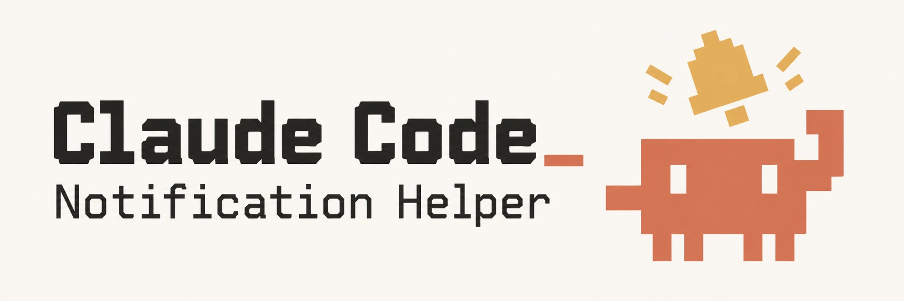
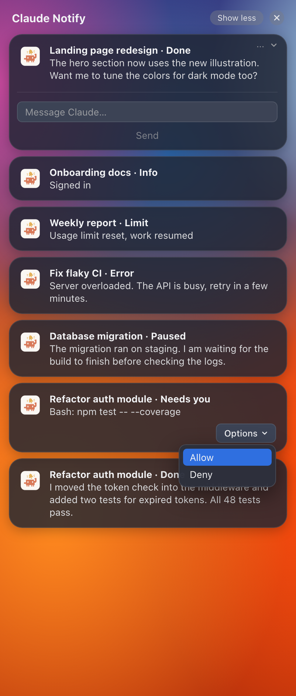
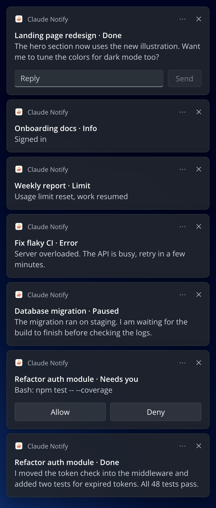

<p align="center">
  
</p>

<p align="center">
  <a href="#onboard-your-agent"></a>
  <a href="https://github.com/franciuto/awesome-claude-notifier/actions/workflows/ci.yml"></a>
</p>

<p align="center">
  <a href="#macos"></a>
  <a href="#windows"></a>
  <a href="#linux"></a>
</p>

# awesome-claude-notifier

Claude Code works for minutes at a time, and you probably don't sit and watch it. This sends you a **macOS, Windows or Linux notification** when something happens: **which session** it was, **what happened**, and **a sound** you learn to recognize. When Claude asks to run a tool or finishes a task, you can **answer from the notification itself**.

| | macOS | Windows | Linux |
|---|:---:|:---:|:---:|
| Notification with session and summary | ✅ | ✅ | ✅ |
| A sound per group | ✅ | ✅ | — |
| **Allow** / **Deny** from the notification | ✅ | ✅ | — |
| **Reply** from the notification | ✅ | ✅ | — |

## What a notification looks like

<table align="center">
  <tr>
    <th>macOS</th>
    <th>Windows</th>
  </tr>
  <tr>
    <td valign="top"></td>
    <td valign="top"></td>
  </tr>
</table>

- **First line:** the session name, the one Claude shows in its session list, followed by what happened.
- **Second line:** the start of Claude's answer, so most of the time you know whether to go back to the terminal without opening it.

> [!NOTE]
> The second line follows **the language you chat in**: chat in Italian and you read "Chiede di usare Bash", chat in English and you read "Asking to use Bash". The group name in the title and the buttons stay in English either way. English and Italian are supported so far.

Every event falls into one of **six groups**, and each group has its own sound:

| Group | When |
|---|---|
| **Needs you** | Claude wants permission or is waiting for an answer |
| **Done** | Claude finished |
| **Paused** | Claude finished, but something is still running in the background |
| **Error** | The turn failed, or auto mode blocked an action |
| **Limit** | You hit a usage limit, or it reset |
| **Info** | Anything else, like signing in |

🔊 Open `sounds/player.html` in a browser to hear them.

## Answering from the notification

Two notifications have controls.

- **Allow / Deny.** When Claude asks to use a tool, the notification shows **Allow** and **Deny** (on macOS they are in the **Options** menu at the bottom right). If you don't answer within **20 seconds** it goes away and the usual prompt appears in the terminal. If the terminal is already the app in front, you get the prompt straight away and no notification.
- **Reply.** When Claude finishes, the notification has a **Reply** field. What you type goes to that session and Claude picks it up immediately. If you go back and type in the terminal instead, the notification is withdrawn.

> [!NOTE]
> Both only work on **macOS and Windows, in terminal sessions**. The Claude desktop app has its own buttons for this, so there you get plain notifications.

## Install

Two ways, same result. Pick one: **let your agent do it**, or **do it by hand** in two commands.

### By hand

Inside Claude Code, run:

```
/plugin marketplace add franciuto/awesome-claude-notifier
/plugin install notifier@awesome-claude-notifier
```

### Onboard your agent

The agent installs the plugin, checks what your system needs, removes old hooks if you had the pip version, and sends you a test notification.

````text
Install the Claude Code plugin `notifier` from the marketplace `awesome-claude-notifier` (GitHub: franciuto/awesome-claude-notifier). It sends desktop notifications for Claude Code events. Do these steps in order, and tell me what you did after each one.

1. Install the plugin. In Claude Code run `/plugin marketplace add franciuto/awesome-claude-notifier`, then `/plugin install notifier@awesome-claude-notifier`. If you can only use a shell, run `claude plugin marketplace add franciuto/awesome-claude-notifier` and then `claude plugin install notifier@awesome-claude-notifier`.

2. In my user settings file (`~/.claude/settings.json`, on Windows `%USERPROFILE%\.claude\settings.json`) set `"preferredNotifChannel": "notifications_disabled"`, so Claude Code's own notifications don't repeat ours. Keep every other setting as it is. If the file doesn't exist, create it.

3. Look in the same file for old hooks whose command runs `claude-notify` or `claude-notify.exe` (possibly quoted or with a full path, such as `...\Scripts\claude-notify.exe`) with the `hook` argument. The plugin's own hooks live in the plugin, not in this file, so any such hook here is old. They come from the earlier pip version and would send every notification twice. Show them to me and remove them once I agree. If `pip show claude-notify` finds the old package, offer to run `pip uninstall claude-notify` too.

4. Check what my system needs:
   - macOS: tell me to allow notifications for "Claude Notify" when macOS asks, and to set its style to Alerts in System Settings, Notifications, Claude Notify. Alerts keep the Allow, Deny and Reply buttons on screen.
   - Windows: check that Git for Windows is installed (`git --version`). The hooks run under Git Bash and don't work without it. If it is missing, tell me to install it from https://git-scm.com/download/win.
   - Linux: check that `notify-send` exists (`command -v notify-send`). If not, tell me how to install it, for example `sudo apt install libnotify-bin`. Linux gets plain notifications only, without buttons.

5. Send a test notification. Find the plugin folder under `~/.claude/plugins/cache/awesome-claude-notifier/notifier/` (it holds one folder per version; use the newest) and run:

   ```bash
   echo '{"hook_event_name":"Stop","session_id":"t","cwd":"/tmp/demo","last_assistant_message":"Test."}' | "<plugin root>/bin/claude-notify" hook
   ```

   Replace `<plugin root>` with that folder. Ask me whether a notification with a sound appeared. If not, show me the command's output and help me find out why.

Finally, tell me to start a new Claude Code session, because hooks are read when a session starts.
````

> [!IMPORTANT]
> Set `"preferredNotifChannel": "notifications_disabled"` in `~/.claude/settings.json` (Windows: `%USERPROFILE%\.claude\settings.json`), so Claude Code's own notifications don't repeat these. A plugin can't set it for you.

**Start a new `claude` session and you're set.** There is nothing to build, no Python, and no hooks to copy: the plugin ships its own hooks and prebuilt binaries.

> [!WARNING]
> **Upgrading from the pip version?** Remove the old setup first, or every notification arrives twice. Delete the hooks in `~/.claude/settings.json` whose command runs `claude-notify` or `claude-notify.exe` (on Windows often a full path such as `...\Scripts\claude-notify.exe`) with the `hook` argument, then run `pip uninstall claude-notify`. You can also delete the sounds in `%LOCALAPPDATA%\claude-notify\sounds` on Windows. The `send` and `check` commands of the old package are gone.

## What each system needs

### macOS

**Needs:** macOS 13 or later.

The first notification copies the bundled `Claude Notify.app` into `~/Applications` and installs the sounds into `~/Library/Sounds`; macOS can't play sounds from inside the app. **Allow notifications** when macOS asks.

> [!TIP]
> In **System Settings → Notifications → Claude Notify**, set the style to **Alerts**, so notifications with buttons stay on screen until you answer.

### Windows

**Needs:** Windows 10 or 11 on x64 or ARM64, and [Git for Windows](https://git-scm.com/download/win): Claude Code runs the plugin hooks under Git Bash.

The notifications are Windows toasts shown by a PowerShell script that ships with the plugin. The first one registers the app as "Claude Notify". In **Settings → System → Notifications** you can turn off Focus assist for it or change how long banners stay.

### Linux

**Needs:** `notify-send` (package `libnotify-bin` on Debian and Ubuntu, `libnotify` on Fedora and Arch).

You get **plain notifications only**: no buttons, no Reply, no sounds. Permission prompts and finished tasks still show up in the terminal as usual.

## Update

Claude Code checks the marketplace when it starts, if auto-update is on for it (`/plugin`, Marketplaces). To update by hand:

```
claude plugin marketplace update awesome-claude-notifier
claude plugin update notifier@awesome-claude-notifier
```

Then **start a new session**. On macOS the first notification after an update installs the new app and sounds by itself.

## Uninstall

```
claude plugin uninstall notifier@awesome-claude-notifier
claude plugin marketplace remove awesome-claude-notifier
```

Then remove `"preferredNotifChannel": "notifications_disabled"` from your settings if you want Claude Code's own notifications back. The plugin leaves a few files outside its folder, which you can delete:

- **macOS:** `~/Applications/Claude Notify.app`, `~/Library/Sounds/claude-notify-*.aiff`, `~/Library/Caches/claude-notify` and `~/Library/Logs/claude-notify-helper.log`.
- **Windows:** `%LOCALAPPDATA%\claude-notify` and the registry key `HKCU\Software\Classes\AppUserModelId\ClaudeNotify.Hook`.

## When something is off

| What you see | Why, and what to do |
|---|---|
| **No notification at all** | Start a new session: hooks are read when a session starts. Then check that notifications are allowed for "Claude Notify" (macOS: System Settings, Notifications; Windows: Settings, System, Notifications) and that Focus or Do Not Disturb is off. |
| **Every notification arrives twice** | Old hooks from the pip version are still in `~/.claude/settings.json`. See "Upgrading from the pip version" above. |
| **Claude Code's own notification shows up as well** | Set `"preferredNotifChannel": "notifications_disabled"`. |
| **The Allow and Deny buttons vanish after a few seconds (macOS)** | The style for Claude Notify is Banners. Set it to Alerts. |
| **No Allow and Deny when Claude asks for permission** | The terminal was the app in front, so you got the usual prompt straight away. That is on purpose. In the Claude desktop app and on Linux there are no buttons at all. |
| **macOS shows an old icon or never asks for permission** | macOS caches both per app. See "Things that bit us" in [docs/how-it-works.md](docs/how-it-works.md). |
| **Nothing happens on Windows** | The hooks run under Git Bash. Check `git --version`, and install [Git for Windows](https://git-scm.com/download/win) if it is missing. |
| **No sound** | macOS: check that `~/Library/Sounds/claude-notify-done.aiff` exists; the next notification puts it back. Windows: the sound plays from the plugin folder, so check the volume of "Windows PowerShell" in the volume mixer. |

To see what the hook does, send a test notification by hand. Use the newest folder under `~/.claude/plugins/cache/awesome-claude-notifier/notifier/`:

```bash
echo '{"hook_event_name":"Stop","session_id":"t","cwd":"/tmp/demo","last_assistant_message":"Test."}' \
  | ~/.claude/plugins/cache/awesome-claude-notifier/notifier/<version>/bin/claude-notify hook
```

On macOS, errors from the app go to `~/Library/Logs/claude-notify-helper.log`.

## Make it yours

- **Sounds.** To change a sound, edit its description in `sounds/generate.sh` and run the script with the group name, for example `./sounds/generate.sh error`. It uses the [ElevenLabs](https://elevenlabs.io) sound effects API, so you need their CLI logged in, and `ffmpeg` for `sounds/soften.sh`, which gives every new sound a short fade-in and caps its loudness. Then run `make dist` and bump `version` in `.claude-plugin/plugin.json`.
- **Icon.** To change the icon, run `python3 assets/icon/make_app_icon.py your-image.png assets/icon/app-icon.png` with any square image. On Windows the icon is `windows/icon.png`: replace that file. On macOS `macos-helper/build.sh` builds `assets/icon/app-icon.png` into the app. In a fork, run `make dist` and bump the version so macOS drops its cached icon.
- **Texts and languages.** The notification texts are in `internal/hook/i18n.go`, one block per language. To add a language, add a block of texts and a list of its common words there, then run `make dist-go`.

For how the pieces fit together, see [docs/how-it-works.md](docs/how-it-works.md).
